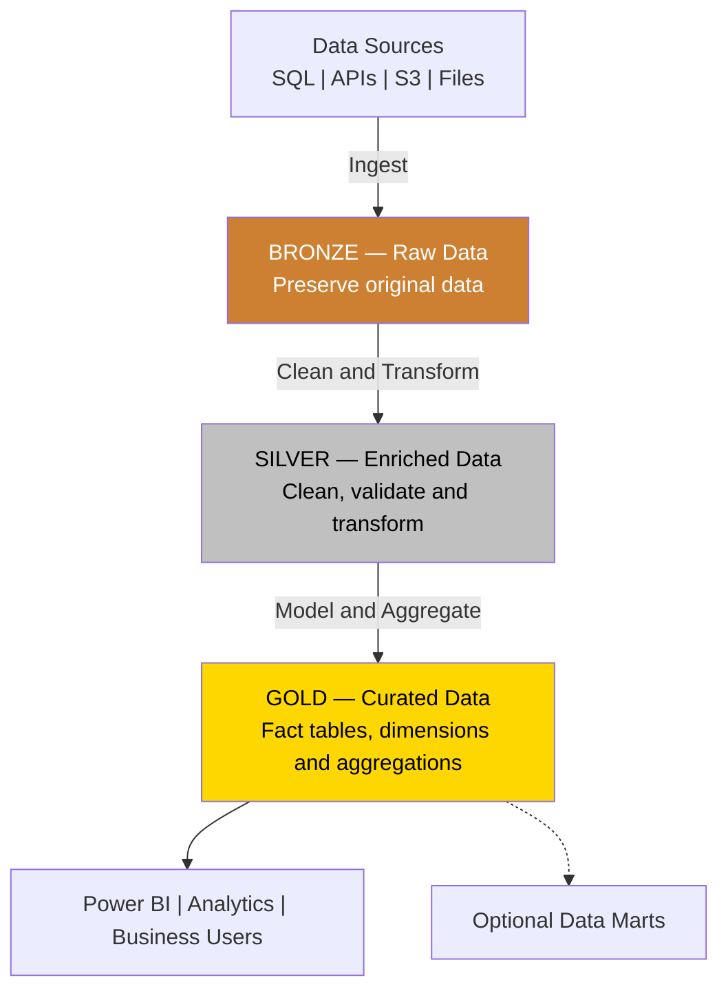

# Medallion Architecture

## 1. What Is Medallion Architecture?

Medallion Architecture is a data engineering design pattern that organizes data into three layers based on its quality and readiness for business consumption.

- **Bronze** — Raw data
- **Silver** — Cleaned and transformed data
- **Gold** — Business-ready data

Each layer progressively improves the quality and usability of the data.

## 2. Medallion Architecture – Data Flow

## Visual Understanding

## 3. Bronze Layer — Raw

The Bronze layer is the initial destination for data ingested from multiple sources.

- Preserves source data as closely as possible.
- Avoids unnecessary business transformations.
- Provides the foundation for downstream processing.

**Purpose:** Data ingestion and raw data preservation.

## 4. Silver Layer — Enriched

The Silver layer receives data from the Bronze layer and transforms it into cleaner, more reliable datasets.

Typical operations include:

- Data cleaning
- Removing duplicates
- Handling missing values
- Data type conversions
- Data validation and transformations

**Purpose:** Improve data quality and reliability.

## 5. Gold Layer — Curated

The Gold layer contains business-ready data designed for reporting, analytics, and decision-making.

It can include:

- Dimensional data models
- Fact tables
- Dimension tables
- Slowly Changing Dimensions (SCD)
- Business-specific aggregations

Business stakeholders, data analysts, and data scientists can consume this data through tools such as Power BI.

**Purpose:** Deliver meaningful, business-ready data.

## 6. Optional Data Marts

Some organizations create additional data marts from curated data to serve specific business departments or requirements.

Examples include sales, finance, and marketing data marts.

Data marts are optional and are not a mandatory fourth layer of Medallion Architecture.

## 7. Layer Comparison

| Feature | Bronze | Silver | Gold |
|---|---|---|---|
| Alternative name | Raw | Enriched | Curated |
| Data quality | Raw | Cleaned | Business-ready |
| Main operation | Ingestion | Transformation | Data modeling |
| Input | Source systems | Bronze | Silver |
| Purpose | Preserve source data | Improve data quality | Business consumption |

## 8. DP-750 Key Takeaways

- Medallion Architecture is a logical data engineering design pattern.
- It progressively improves data quality across three layers.
- Bronze preserves raw source data.
- Silver cleans and transforms data.
- Gold prepares data for business consumption.
- Data marts are optional.
- Medallion Architecture is not exclusive to Databricks.

**Remember: Bronze = Ingest | Silver = Transform | Gold = Serve.**