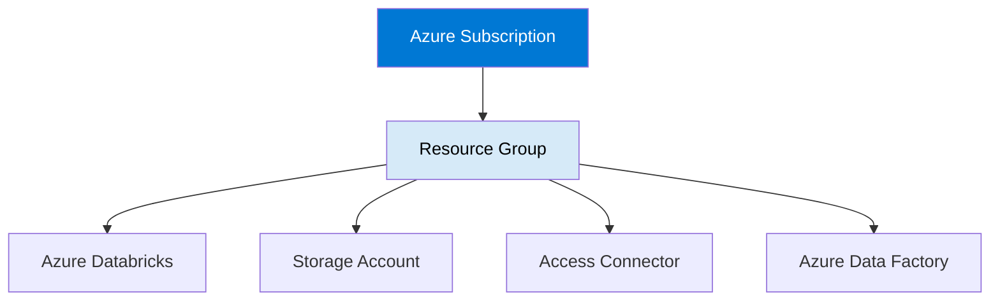
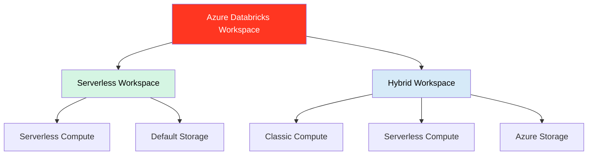
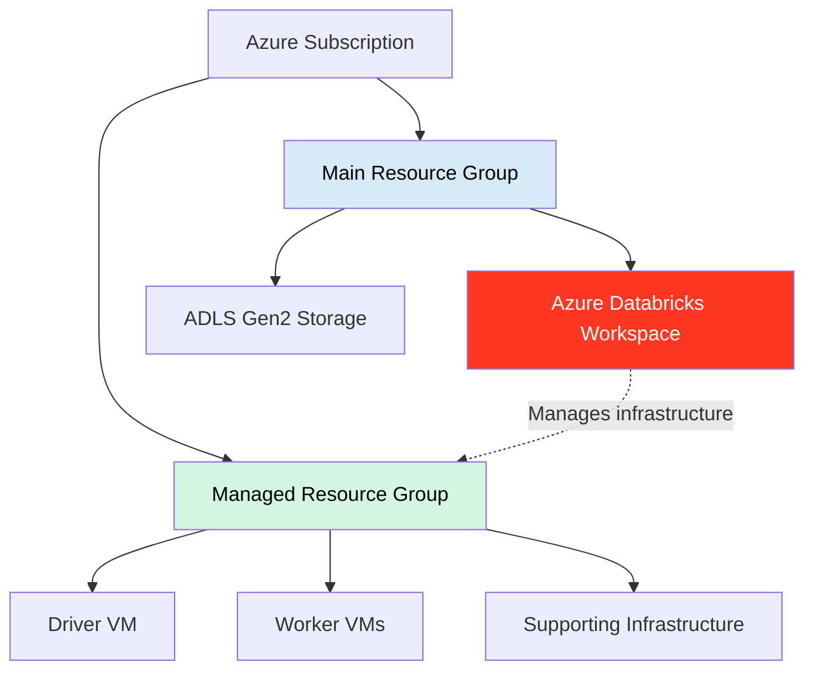
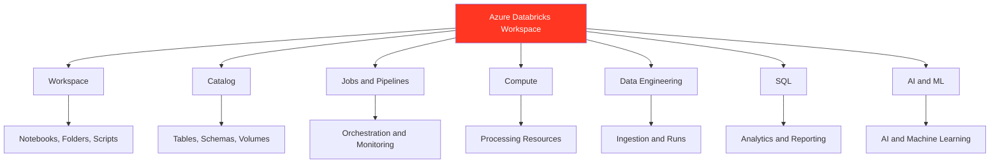

# Azure Databricks Workspace Setup

## 1. Azure Resources and Resource Groups

### Azure Resource

A resource is an individual service or manageable component deployed in Azure.

Examples:

- Azure Databricks
- Azure Data Factory
- Azure Storage Account
- Virtual Machines
- Azure Databricks Access Connector

### Azure Resource Group

A resource group is a logical container used to organize and manage related Azure resources.

Resources belonging to the same project can be grouped together for easier management.



## 2. Microsoft Entra ID

Microsoft Entra ID, formerly Azure Active Directory, is Microsoft's cloud-based identity and access management service.

It helps manage:

- Users and groups
- Authentication
- Application identities
- Service principals

Entra ID provides identities, while Azure RBAC controls what those identities can access within Azure resources.

## 3. Creating an Azure Resource Group

1. Sign in to the Azure Portal.
2. Search for **Resource groups**.
3. Select **Create**.
4. Select the appropriate subscription.
5. Enter a resource group name.
6. Select a region.
7. Select **Review + create**.
8. Select **Create**.

Example configuration used in the course:

| Setting | Value |
|---|---|
| Resource group | azure-databricks |
| Region | Canada Central |

For production workloads, select regions based on service availability, latency, compliance, and business requirements.

## 4. Creating an Azure Databricks Workspace

Navigate to the resource group and select **Create**.

Search for **Azure Databricks** in Azure Marketplace and select the official service.

### Workspace Configuration

| Setting | Description |
|---|---|
| Subscription | Azure subscription used for deployment and billing |
| Resource group | Container for the Databricks workspace |
| Workspace name | Name of the Databricks workspace |
| Region | Azure region where the workspace is deployed |
| Pricing tier | Trial or Premium, depending on eligibility |
| Workspace type | Serverless or Hybrid |
| Managed resource group | Resource group managed by Azure Databricks |

## 5. Pricing Tier

The instructor demonstrates two pricing options.

### Trial

- Provides a 14-day Premium trial for eligible users.
- Useful for learning and experimentation.
- Can be upgraded after the trial.

### Premium

- Paid pricing tier.
- Provides Premium workspace capabilities.
- Charges depend on resource consumption and workload configuration.

**Cost caution:** A Databricks trial does not necessarily eliminate all Azure infrastructure or storage charges. Monitor Azure costs and stop unused compute.

## 6. Workspace Types

Azure Databricks provides different workspace deployment options.

### Serverless Workspace

- Uses Databricks-managed serverless compute.
- Includes Databricks-managed default storage.
- Requires less infrastructure configuration.

### Hybrid Workspace

- Supports classic compute in the customer's Azure environment.
- Supports serverless compute for eligible workloads.
- Supports customer-managed Azure storage.
- Provides greater flexibility for compute configuration.

The instructor selects **Hybrid** because the course covers both classic and serverless compute.



## 7. Managed Resource Group

When deploying a hybrid Azure Databricks workspace, Azure Databricks creates a managed resource group for infrastructure resources that it manages.

For example, when a classic compute cluster is created, its underlying Azure VMs and associated infrastructure can be provisioned in the managed resource group.

### Main vs. Managed Resource Group

| Main Resource Group | Managed Resource Group |
|---|---|
| Managed by the customer | Managed by Azure Databricks |
| Contains the workspace resource and other project resources | Contains Databricks-managed infrastructure |
| Used for project resource management | Used for supporting workspace infrastructure |
| Customer manages resources | Avoid manually modifying managed resources |

### Recommended Naming Convention

```text
azure-databricks
azure-databricks-managed
```

Using related names makes it easier to identify which managed resource group belongs to a particular project.

### Resource Group Architecture



**Important:** Do not manually modify or delete resources inside the managed resource group unless explicitly supported by Databricks.

## 8. Launching the Databricks Workspace

After configuring the workspace:

1. Select **Review + create**.
2. Complete configuration validation.
3. Select **Create**.
4. Wait for deployment to complete.
5. Navigate to the main resource group.
6. Open the Azure Databricks resource.
7. Select **Launch Workspace**.

The Azure Databricks web application opens, providing access to notebooks, compute, pipelines, jobs, and other workspace features.

The web application belongs to the **Control Plane**, while workload execution happens in the **Compute Plane**.

## DP-750 Key Takeaways

- An Azure resource is an individual deployed service or component.
- A resource group logically organizes related Azure resources.
- Microsoft Entra ID manages identities and authentication.
- Hybrid workspaces support classic and serverless compute.
- Serverless workspaces simplify infrastructure configuration.
- The managed resource group contains infrastructure managed by Azure Databricks.
- Avoid manually modifying the managed resource group.
- Launch Workspace opens the Databricks Control Plane interface.

**Remember: Main Resource Group = Project Resources | Managed Resource Group = Databricks-managed Infrastructure.**

## 9. Azure Databricks Workspace Overview

The Azure Databricks workspace provides a unified interface for developing, managing, executing, and monitoring data workloads.

### Workspace Navigation



### Main Workspace Components

| Component | Purpose |
|---|---|
| Workspace | Develop and organize notebooks, folders, scripts, and Git folders |
| Recents | Access recently opened objects |
| Catalog | Manage data assets through Unity Catalog |
| Jobs and Pipelines | Create, schedule, and monitor workflows |
| Compute | Configure and manage processing resources |
| Marketplace | Discover datasets, connectors, and partner offerings |
| SQL | Perform SQL analytics and reporting |
| Data Engineering | Manage data ingestion and monitor runs |
| AI and ML | Develop AI and machine learning workloads |

## 10. Personal Workspace Directory

Each user has a personal working directory within the Databricks workspace.

```text
Workspace/
├── Users/
│   ├── user1@example.com/
│   │   ├── Notebooks/
│   │   ├── Scripts/
│   │   └── Git Folders/
│   │
│   └── user2@example.com/
│
└── Shared/
```

The personal directory is used to develop and organize code and workspace objects.

## 11. Unity Catalog

Unity Catalog is the centralized data governance solution in Databricks.

The Catalog interface allows users to discover and manage:

- Catalogs and schemas
- Tables
- Functions
- Volumes

Unity Catalog will be covered in detail in a dedicated course section.

## 12. Compute Resources

The Compute section provides access to different processing resources and related services.

| Compute or Service | Purpose |
|---|---|
| All-purpose compute | Interactive development and data processing |
| Job compute | Automated workload execution |
| SQL warehouses | SQL queries and analytical workloads |
| Pools | Reduce cluster startup time using ready-to-use instances |
| Compute policies | Control permitted compute configurations |
| AI Search | Search capabilities for AI applications |
| Apps | Build and deploy applications |
| Lakebase | Supports operational database and OLTP workloads |

## 13. Data Engineering Section

The Data Engineering section provides access to:

- **Data Ingestion:** Connect to external data sources and ingest data.
- **Runs:** Monitor workload and pipeline executions.

Databricks provides multiple connectors to simplify data ingestion.

## 14. Workspace Settings and Preview Features

### Change Workspace Theme

Profile Icon → Settings → Preferences → Light or Dark Mode

### Change Code Editor Theme

Profile Icon → Settings → Developer → Code Editor

### Preview Features

Databricks introduces new features through different release stages.

| Release Stage | Meaning |
|---|---|
| Beta / Preview | Features that may require opt-in and have limited availability |
| Generally Available (GA) | Features officially released for supported production use |

If a feature demonstrated in the course is unavailable:

1. Check the workspace's Previews section.
2. Check whether the feature requires manual activation.
3. Verify regional availability and permissions.
4. Enable the feature if supported and refresh the workspace if necessary.

## DP-750 Key Takeaways — Workspace Navigation

- Workspace is the development environment.
- Unity Catalog manages and governs data assets.
- Compute provides processing resources.
- Jobs and Pipelines manage workflow execution.
- Data Ingestion connects external data sources.
- Runs helps monitor executions.
- Preview features may require activation.

**Remember: Workspace = Develop | Catalog = Govern | Compute = Process | Jobs and Pipelines = Orchestrate.**