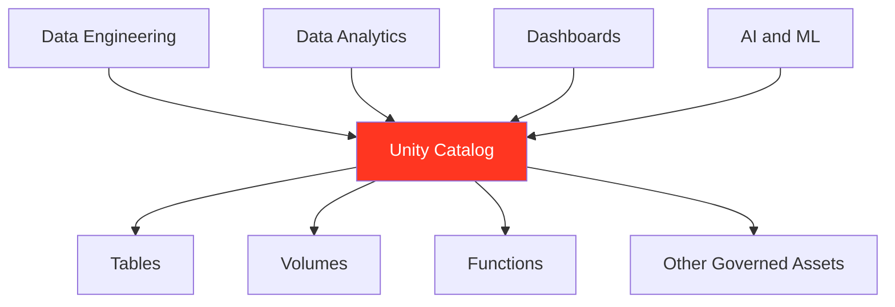
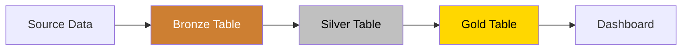
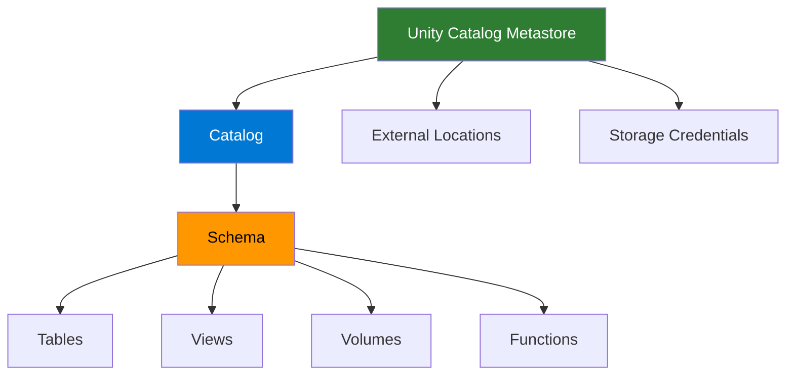

# Introduction to Unity Catalog

## 1. What is Unity Catalog?

Unity Catalog is the **unified data governance solution** in Databricks.

It provides centralized governance across data engineering, data analytics, dashboards, machine learning, and AI workloads.

Data governance means managing, securing, organizing, monitoring, and controlling how data is accessed and used.

## 2. Unity Catalog Architecture

Unity Catalog acts as a common governance layer across different Databricks workloads.



## 3. Core Capabilities of Unity Catalog

| Capability | Purpose |
|---|---|
| Data Lineage | Track the origin, movement, and dependencies of data |
| Access Control | Control who can access or modify data |
| Data Discovery | Discover and explore available data assets |
| Data Quality Monitoring | Monitor data quality and detect issues |
| Data Classification | Categorize data assets using tags |
| Data Sharing | Securely share data with other users or organizations |

### Data Lineage

Data lineage tracks where data comes from, how it is transformed, and where it goes.

It helps data engineers understand dependencies, troubleshoot failures, and identify affected downstream assets.



If a Gold table has incorrect data, lineage helps trace the upstream Silver and Bronze tables to investigate the issue.

### Access Control

Controls which users can perform operations on data assets.

For example, a junior developer may have permission to read a table but not insert or update its data.

### Data Discovery

Catalog Explorer allows users to discover, explore, and understand available data assets in Databricks.

### Data Quality Monitoring

Helps monitor data quality, identify anomalies, and detect potential data issues.

### Data Classification

Tags help categorize and organize data assets such as catalogs, schemas, tables, and functions.

This makes managing large numbers of data assets easier.

### Data Sharing

Unity Catalog supports secure data sharing through Delta Sharing.

Organizations can share data with authorized recipients.

## DP-750 Key Takeaways

- Unity Catalog is a centralized data governance solution.
- It governs data and AI assets across Databricks workloads.
- Data lineage helps track dependencies and troubleshoot issues.
- Access control restricts unauthorized operations.
- Catalog Explorer enables data discovery.
- Tags support data classification.
- Delta Sharing enables secure data sharing.

**Remember: Unity Catalog = Unified Data Governance.**

## 4. Unity Catalog Hierarchy

Unity Catalog follows a hierarchical structure similar to traditional relational databases.

The metastore is the highest level, followed by catalogs, schemas, and data objects.

### Hierarchy Visualization



### Hierarchy Components

| Component | Purpose |
|---|---|
| Metastore | Top-level container for governed assets and their metadata |
| Catalog | Organizes schemas |
| Schema | Organizes tables, views, volumes, and functions |
| Table | Stores structured data |
| View | Represents data through a query |
| Volume | Provides governed access to non-tabular files |
| Function | Stores reusable logic |
| External Location | Defines an external cloud storage path and its associated storage credential |
| Storage Credential | Provides an authentication mechanism for accessing cloud storage |

External locations and storage credentials exist directly under the metastore, at the same hierarchy level as catalogs.

## 5. Three-Level Namespace

Unity Catalog uses a three-level namespace to identify data objects.

```text
catalog.schema.object
```

For a table:

```text
catalog.schema.table
```

Example:

```sql
SELECT * FROM sales_catalog.gold.customers;
```

Here:

- `sales_catalog` is the catalog.
- `gold` is the schema.
- `customers` is the table.

The metastore is not included in the three-level namespace.

## 6. Comparison with Traditional Databases

| PostgreSQL | Unity Catalog |
|---|---|
| Database | Catalog |
| Schema | Schema |
| Table | Table |
| View | View |
| Function | Function |

The hierarchy is conceptually similar, making Unity Catalog easier to understand for developers with a SQL background.

## 7. Hive Metastore vs. Unity Catalog

Hive Metastore is the legacy metadata management system used in Databricks before Unity Catalog.

| Hive Metastore | Unity Catalog |
|---|---|
| Legacy metadata management | Modern unified governance |
| Workspace-level metadata management | Centralized governance across assigned workspaces |
| Limited governance capabilities | Advanced access control, lineage, discovery, and sharing |

Unity Catalog is the recommended approach for modern Databricks projects.

## 8. Default Catalogs and Unity Catalog Setup

Modern Azure Databricks workspaces may be automatically enabled for Unity Catalog and contain a default workspace catalog.

Common schemas include:

- `default`
- `information_schema`

The course creates a custom catalog to demonstrate Unity Catalog configuration and integration with Azure cloud storage.

Upcoming topics include:

- Metastore configuration
- Workspace assignment
- Azure Data Lake Storage integration
- Storage credentials
- External locations
- Catalog creation

## DP-750 Key Takeaways — Unity Catalog Hierarchy

- Metastore is the highest level of the hierarchy.
- A metastore can contain multiple catalogs.
- A catalog can contain multiple schemas.
- Schemas contain tables, views, volumes, and functions.
- External locations and storage credentials are metastore-level objects.
- Unity Catalog uses a three-level namespace: `catalog.schema.object`.
- Hive Metastore is the legacy approach.

**Remember: Metastore → Catalog → Schema → Data Objects.**