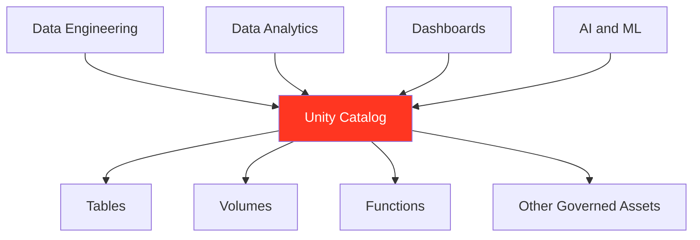
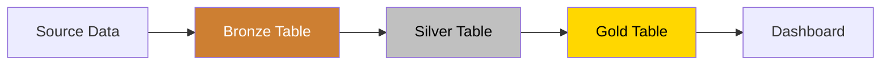

# Introduction to Unity Catalog

## 1. What is Unity Catalog?

Unity Catalog is the **unified data governance solution** in Databricks.

It provides centralized governance across data engineering, data analytics, dashboards, machine learning, and AI workloads.

Data governance means managing, securing, organizing, monitoring, and controlling how data is accessed and used.

## 2. Unity Catalog Architecture

Unity Catalog acts as a common governance layer across different Databricks workloads.

## 3. Core Capabilities of Unity Catalog

| Capability | Purpose |
|---|---|
| Data Lineage | Track the origin, movement, and dependencies of data |
| Access Control | Control who can access or modify data |
| Data Discovery | Discover and explore available data assets |
| Data Quality Monitoring | Monitor data quality and detect issues |
| Data Classification | Categorize data assets using tags |
| Data Sharing | Securely share data with other users or organizations |

### Data Lineage

Data lineage tracks where data comes from, how it is transformed, and where it goes.

It helps data engineers understand dependencies, troubleshoot failures, and identify affected downstream assets.

If a Gold table has incorrect data, lineage helps trace the upstream Silver and Bronze tables to investigate the issue.

### Access Control

Controls which users can perform operations on data assets.

For example, a junior developer may have permission to read a table but not insert or update its data.

### Data Discovery

Catalog Explorer allows users to discover, explore, and understand available data assets in Databricks.

### Data Quality Monitoring

Helps monitor data quality, identify anomalies, and detect potential data issues.

### Data Classification

Tags help categorize and organize data assets such as catalogs, schemas, tables, and functions.

This makes managing large numbers of data assets easier.

### Data Sharing

Unity Catalog supports secure data sharing through Delta Sharing.

Organizations can share data with authorized recipients.

## DP-750 Key Takeaways

- Unity Catalog is a centralized data governance solution.
- It governs data and AI assets across Databricks workloads.
- Data lineage helps track dependencies and troubleshoot issues.
- Access control restricts unauthorized operations.
- Catalog Explorer enables data discovery.
- Tags support data classification.
- Delta Sharing enables secure data sharing.

**Remember: Unity Catalog = Unified Data Governance.**