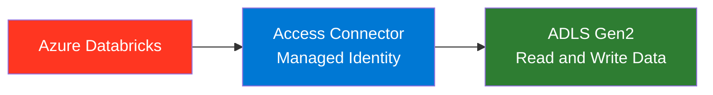
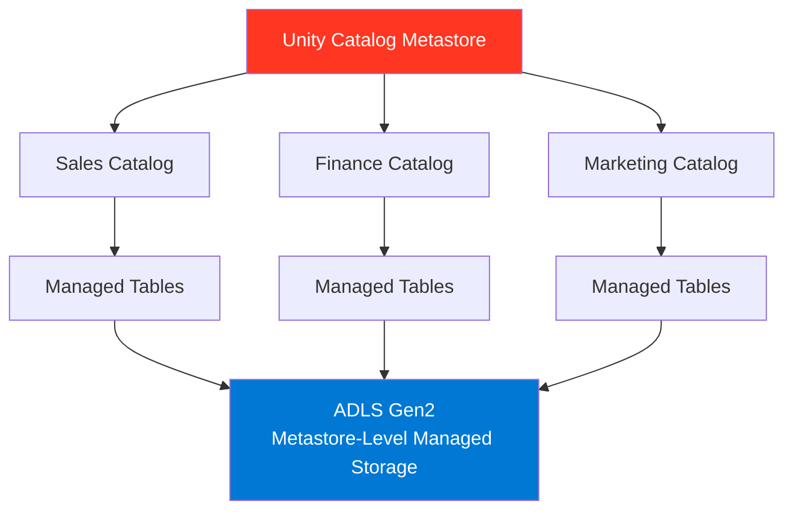
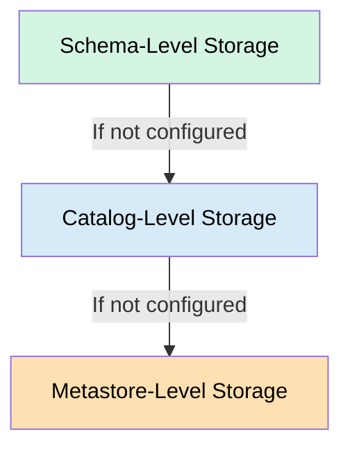

# Unity Catalog and Metastore Setup

## 1. Where Does Databricks Store Data?

Databricks separates data storage, processing, and governance.

| Component | Responsibility |
|---|---|
| ADLS Gen2 | Stores actual data files |
| Unity Catalog | Manages metadata, definitions, and permissions |
| Compute | Processes data and executes code |

Table definitions, schema definitions, function definitions, and other metadata are registered in Unity Catalog, while the actual table data resides in cloud storage.

## 2. Connecting Databricks to ADLS Gen2

Azure Data Lake Storage is secured. Databricks needs appropriate authentication and authorization to read and write data.

To establish this connection, we use an **Access Connector for Azure Databricks**.

### Access Connector

An Access Connector is an Azure resource that provides a managed identity for Azure Databricks to authenticate to Azure storage.

The managed identity must be granted appropriate storage permissions, such as Storage Blob Data Contributor for read and write operations.



This avoids the need to manually manage storage account keys or passwords.

The Access Connector provides an identity; it does not physically transfer the data.

## 3. Storage Credentials and External Locations

Unity Catalog uses storage credentials and external locations to govern access to cloud storage.

| Component | Purpose |
|---|---|
| Access Connector | Provides an Azure managed identity |
| Storage Credential | Represents the authentication mechanism in Unity Catalog |
| External Location | Associates a cloud storage path with a storage credential |

**Storage Credential = How to access storage.**

**External Location = Where the storage is and how to access it.**

## 4. Managed Tables

A managed table is a table for which Unity Catalog manages both the metadata and the underlying data lifecycle.

When a developer creates a managed table without specifying a data location, Databricks determines where to store its data using the configured managed storage location.

```sql
CREATE TABLE sales_catalog.bronze.customers (
    customer_id INT,
    customer_name STRING
);
```

The developer does not need to manually specify the physical file path.

## 5. Metastore-Level Managed Storage

A Unity Catalog metastore can be configured with a managed storage location in ADLS Gen2.

This provides a default storage location for managed tables and volumes when no more specific managed storage location is configured.



Benefits of metastore-level managed storage:

- Provides a common default storage location.
- Reduces repetitive storage configuration.
- Allows Databricks to manage underlying data directories.
- Simplifies managed table creation.

## 6. Managed Storage Location Hierarchy

Managed storage can be configured at three levels:



Databricks uses the most specific configured managed storage location.

| Priority | Storage Level |
|---|---|
| 1 | Schema |
| 2 | Catalog |
| 3 | Metastore |

The instructor prefers metastore-level storage because it simplifies the configuration for multiple catalogs.

However, catalog-level and schema-level storage can also be useful when different departments or environments require separate storage locations.

## 7. Required Azure Resources

For the upcoming Unity Catalog setup, we need the following Azure resources:

- Azure Databricks Workspace — already created.
- ADLS Gen2 Storage Account — stores actual data.
- Access Connector for Azure Databricks — provides a managed identity for storage access.

The next practical lesson will demonstrate the creation and configuration of these resources.

## DP-750 Key Takeaways

- Unity Catalog governs data; ADLS Gen2 stores actual data.
- Access Connector provides a managed identity for Azure storage authentication.
- Appropriate Azure storage permissions must be assigned to the managed identity.
- Storage credentials represent authentication mechanisms.
- External locations associate storage paths with credentials.
- Managed tables allow Unity Catalog to manage the underlying data lifecycle.
- Managed storage can be configured at schema, catalog, or metastore level.
- The most specific configured managed storage location takes precedence.

**Remember: Metastore governs, Access Connector authenticates, and ADLS Gen2 stores.**